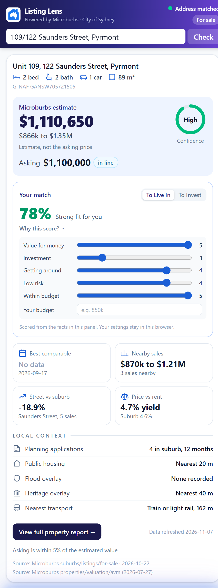
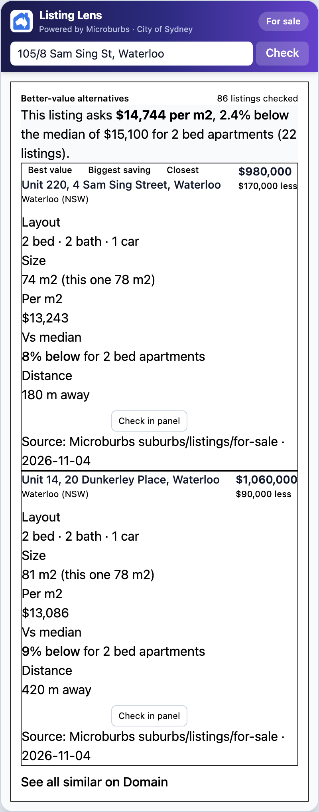
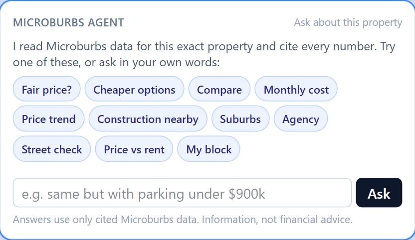
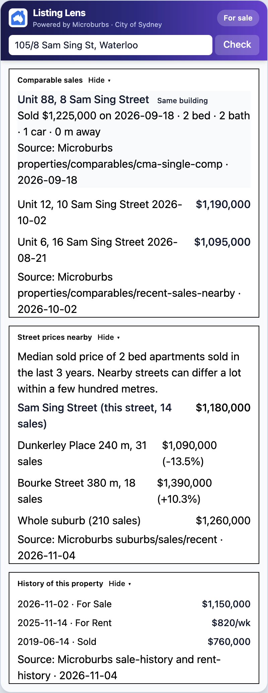
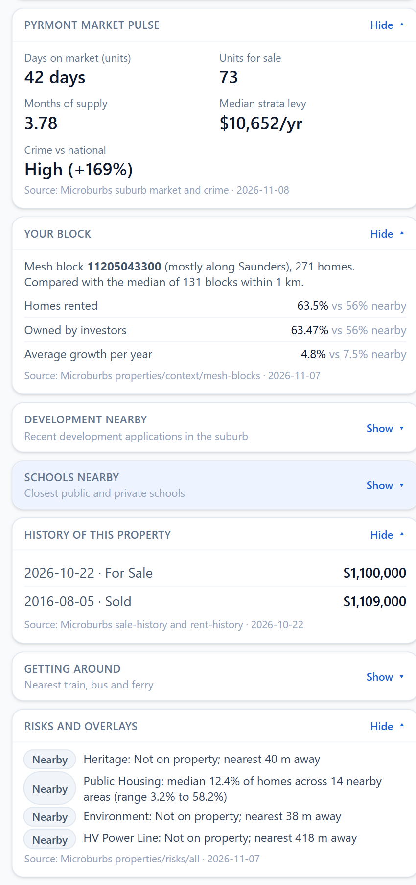

# Microburbs Listing Lens

A Chrome extension that shows Microburbs data for the exact unit beside listings on domain.com.au and realestate.com.au in the City of Sydney: is the price fair, what is the catch, and is there something better nearby. Every number carries its source and date.

Built for the Microburbs hackathon, 7 November 2026 (Task 3, Chrome extension; Task 4, flat rent model).

## The panel

These are the real side-panel components, filled with a sample listing at Unit 105, 8 Sam Sing Street, Waterloo, so the layout is visible here. On a live listing the numbers come from the Microburbs API, and each one keeps its source and date.

The address is matched to one G-NAF unit. The price check compares the asking price with the Microburbs valuation, then adds a street check and a rent yield.



Cheaper like-for-like listings nearby, with the saving, size and price per square metre.



The assistant answers only from cited Microburbs data.



Same-building and nearby sales, street medians, and this flat's own sale and rent history.



Suburb market, the census block against the blocks around it, and risk overlays.



## Install (about 30 seconds)

Chrome only installs extensions without extra clicks from the Web Store, so the installer does everything else and leaves you two clicks.

**Windows** (PowerShell):

```powershell
irm https://raw.githubusercontent.com/cryptotweezer/Microburbs_Hackathon/main/install/install.ps1 | iex
```

**macOS / Linux**:

```sh
curl -fsSL https://raw.githubusercontent.com/cryptotweezer/Microburbs_Hackathon/main/install/install.sh | sh
```

Then, in the Chrome tab that opens:

1. Turn on **Developer mode** (top right).
2. Click **Load unpacked** and pick the folder the installer opened (`%LOCALAPPDATA%\ListingLens` on Windows, `~/ListingLens` on macOS).

### Manual install

1. Download `listing-lens.zip` from the [latest release](https://github.com/cryptotweezer/Microburbs_Hackathon/releases/latest) and unzip it.
2. Open `chrome://extensions`, turn on **Developer mode**, click **Load unpacked** and select the unzipped folder.

### Use it

Open any City of Sydney listing, for example in Pyrmont, Ultimo or Surry Hills, and click the Listing Lens icon in the toolbar. The side panel opens beside the listing.

## What it does

The panel reads top to bottom.

**Header.** The address from the listing, whether it matched, and whether the listing is for sale or for rent. For sale or for rent comes from Microburbs' own listings index. If the property is not in that index, the panel says the mode is a guess and lets you switch it. You can also type an address and press Check.

**Address match.** A clear listing resolves to one G-NAF unit and the overview opens. An unclear one stops on an address card: building only, a list of units to pick from, an address the portal withheld, or outside the 29 City of Sydney suburbs. Nothing below that card loads until the unit is exact.

**Overview.** The matched address, beds, baths, cars, size, and G-NAF id. Then the estimate: Microburbs valuation for a sale, or fair rent from our model for a rental (with a car space and without). The range sits under the figure. Confidence is High, Medium, or Low from the method behind it: the valuation or rent model, a sale in the same building, or nearby comparables only. The asking price is shown against that estimate. If Microburbs has no asking price, you can type the one on the portal. On a sale, a line under the estimate gives the likely sale price from how that agency usually quotes.

**Your match.** The listing decides the profile: a rental is scored as a renter, and a sale asks whether you are buying to live in or to invest. The first time, you only see sliders for value for money, investment, transport, risk, and budget, plus an optional budget; the score appears once you set them (or pick the suggested settings). Investment is left off for a rental. The score is calculated in the browser from facts already on the panel, and the settings stay in this browser.

**Tiles and local context.** Four tiles: for a sale, the same-building or best comparable, the range of nearby sales, this street against the suburb, and gross yield against the suburb yield. For a rental, fair rent with and without a car space, the last lease, and the asking rent. Under the tiles: planning applications in the suburb over 12 months, public housing, flood, heritage, and the nearest train, light rail, ferry, or bus stop. A button scrolls to the full report. Every figure on the overview keeps its source and date.

**Microburbs Agent.** A chat under the overview. Suggested questions cover price, cheaper options, repayments, suburb comparisons, the agency, the street, yield, and the block. Answers use cited Microburbs data. On a rental the suggestions switch to rent, transport, and risks.

**Better-value alternatives.** Up to three similar listings nearby, with the saving, beds and baths, size, price per square metre, and distance. Each one can be opened on Domain or checked in the panel. If the listing has no asking price, the card shows similar listings instead of cheaper ones.

**Full property report.** Collapsed cards, loaded when opened: how this agency quotes, comparable sales, street prices nearby, the suburb market pulse, your census block, development applications, schools, sale and rent history, transport, and risks and overlays. Sale-only cards are hidden on a rental.

## Who it helps

Buyers and renters looking at a City of Sydney flat who want to know, beside the listing, whether the price is fair and what the listing does not say. Investors get yield against the suburb and the agency's quoting pattern.

## The clever step

Most tools show facts for the building or the suburb. Listing Lens resolves the listing to one G-NAF unit first and refuses to show anything until that match is certain, so every number is about the flat on screen. The same unit-level rent model that we built for Task 4 drives the fair rent in the panel.

## Task 4: flat rents

`rents_mesh-block-party.csv` has a weekly rent with and without a car space for all 65,777 flats. On our own time holdout (2,210 leases from April and May 2026, features stopped at 31 March) the median absolute error was $52.44 a week, 74.8% within $100, R² 0.837, against the published $86 and 55.2% for the Microburbs model. Method and limits are in [report.html](report.html). The pipeline is in `ml/` (`cd ml && uv run pytest`). The organisers' Task 4 files are not committed; to rebuild the CSV, put them in `data/raw/task4/` and follow [ml/README.md](ml/README.md).

## Data and credits

- Microburbs API (property, suburb and listing data) and the organisers' Task 4 files.
- Addresses: G-NAF, © Geoscape Australia, licensed under the Open G-NAF End User Licence Agreement.
- Census blocks: Australian Bureau of Statistics, CC BY 4.0.

No API key, organiser file or API output is stored in this repository; only our own predictions (the CSV).

## Privacy and safety

The extension reads only the listing address from the page. Match preferences stay in this browser and are not sent to the server. API keys live on the server, never in the extension. The backend caps data spend per day, rate limits each connection and the assistant, and accepts requests only from this extension.

## Development

```bash
pnpm install
pnpm --filter web dev          # backend on :3000 (needs .env, see .env.example)
pnpm --filter extension dev    # extension with hot reload
pnpm -r typecheck && pnpm -r test
cd ml && uv run pytest         # rent model
```

Stack: Next.js 16 route handlers, WXT + React 19 (MV3 side panel), Zod contracts, Upstash Redis, AI SDK with Claude Haiku, Python + LightGBM for the rent model.
